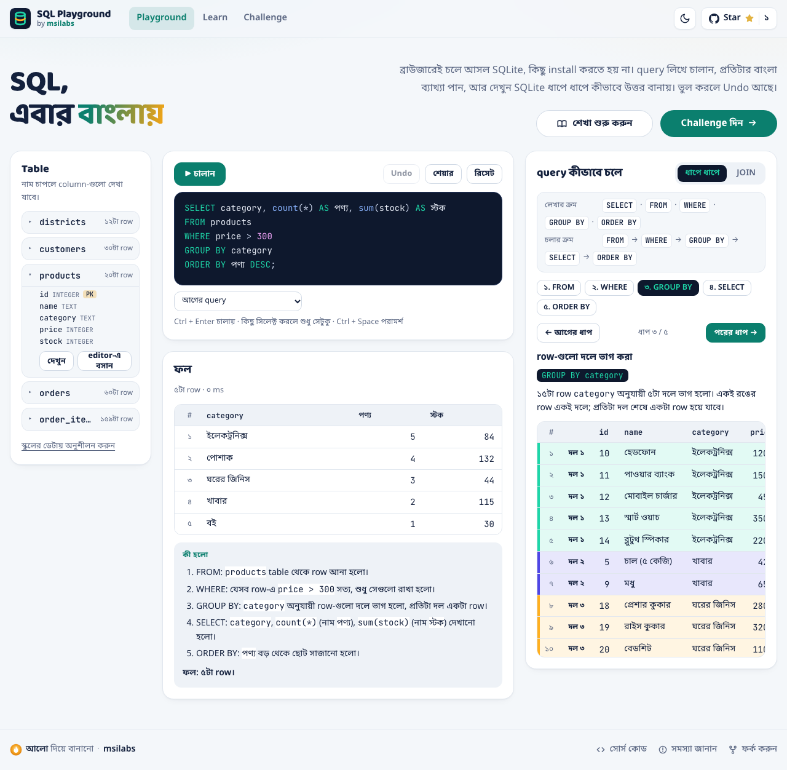

# SQL Playground

[](https://github.com/msilabs/sql-playground/actions/workflows/ci.yml) [](LICENSE)

ব্রাউজারে SQL শেখার জায়গা। query লিখলে আসল SQLite চালায়, তারপর বাংলায় বলে দেয় কী হলো। query ভেতরে কোন ক্রমে চলে (FROM → WHERE → GROUP BY → HAVING → SELECT → ORDER BY → LIMIT), প্রতিটা ধাপের পরে table দেখতে কেমন, আর JOIN-এ কোন row কোন row-এর সাথে মিলল, সব চোখে দেখা যায়। ৩৫টা আলাদা পাঠে শিখুন, ২৮টা challenge-এ নিজেকে যাচাই করুন।

**লাইভ:** https://msilabs.github.io/sql-playground/



কোনো সার্ভার, লগইন বা ডেটাবেস নেই। SQLite চলে আপনার ব্রাউজারে ([sql.js](https://github.com/sql-js/sql.js), WebAssembly), আর আপনার কাজ সেভ থাকে এই ব্রাউজারের `localStorage`-এ।

## তিনটা অংশ

- **Playground** (home): খোলা editor, ফল, "query কীভাবে চলে" আর table-এর তালিকা। যা খুশি চালান, বদলগুলো browser-এ সেভ থাকে।
- **Learn:** ৩৫টা পাঠ, প্রতিটা একটা বিষয় নিয়ে: SELECT, DISTINCT, WHERE, অপারেটর, AND/OR/NOT, ORDER BY, LIMIT, NULL, LIKE, IN, BETWEEN, AS, INSERT, UPDATE, DELETE, INSERT … SELECT, COUNT, SUM, AVG, MIN/MAX, GROUP BY, HAVING, JOIN-এর সব রকম (INNER, LEFT, RIGHT, FULL, self), UNION, subquery, EXISTS, CASE, IFNULL/COALESCE আর comment। প্রতিটা পাঠ নিজে নিজে সম্পূর্ণ, তাই যেটা লাগে সেটা সরাসরি খোলা যায়। প্রতিটায় আসল ডেটার ওপর চালানো-যায় এমন SQL বাক্স; প্রতিটা বাক্সের নিজের DB, তাই এক বাক্সের UPDATE আরেকটায় পড়ে না।
- **Challenge:** ২৮টা, সহজ থেকে কঠিন। কী বের করতে হবে বলা থাকে, query নিজে লিখতে হয়। যাচাই হয় ফল মিলিয়ে, তাই যেকোনো সঠিক query চলে। প্রতিটা challenge নিজের নতুন DB-তে চলে, সাথে ইঙ্গিত, উত্তর আর সংশ্লিষ্ট পাঠের লিংক। একটা শেষ হলে পরেরটা খোলে।

## যা যা আছে

- **আসল SQLite:** JOIN (RIGHT আর FULL-সহ), subquery, CTE, window ফাংশন, INSERT/UPDATE/DELETE, CREATE TABLE, সব চলে। একসাথে কয়েকটা statement দিলে প্রতিটার ফল আলাদা দেখায়।
- **বাংলায় ব্যাখ্যা:** প্রতিটা query-র পরে ধাপে ধাপে কী হলো। WHERE ছাড়া UPDATE বা DELETE দিলে সতর্কবার্তা।
- **বাংলায় ভুল আর ইঙ্গিত:** `no such column: custmer_id` এলে বলে দেয় "আপনি কি `customer_id` বোঝাতে চেয়েছেন?"। আসল ইংরেজি বার্তাও দেখা যায়।
- **ধাপে ধাপে:** প্রতিটা clause-এর পরের table। WHERE-এ কোন row টিকল আর কোনটা বাদ গেল, GROUP BY-তে কোন row কোন দলে (রঙে), HAVING-এ কোন দল টিকল।
- **JOIN-এর ছবি:** দুই table পাশাপাশি, মিলে যাওয়া row-গুলো লাইনে জোড়া। LEFT JOIN-এ কোথায় NULL বসল তা আলাদা রঙে।
- **বাংলাদেশি ডেটা:** "অনলাইন দোকান" (জেলা, গ্রাহক, পণ্য, অর্ডার, bKash/Nagad পেমেন্ট) আর "স্কুল" (শ্রেণি, শিক্ষার্থী, বিষয়, নম্বর)।
- **নিরাপদে ভুল করা:** Undo দিয়ে শেষ বদল বাতিল, রিসেট দিয়ে শুরুর অবস্থা। শেষ না হওয়া query ৩ সেকেন্ডে থেমে যায়, পেজ আটকায় না।
- **Editor:** রঙিন SQL, table/column/keyword-এর autocomplete (`Ctrl + Space`), `Ctrl + Enter` দিয়ে চালানো, সিলেক্ট করা অংশ আলাদা চালানো।
- **শেয়ার লিংক:** query আর dataset লিংকের `#` অংশে থাকে, সার্ভারে কিছু যায় না। পাঠের প্রতিটা বাক্স থেকে এক চাপে Playground-এ খোলা যায়।
- আলো/অন্ধকার থিম, মোবাইলে চলে।

## চালানো

সাইট বানানো হয় [আলো (Alo)](https://github.com/msilabs/alo) দিয়ে। Node.js ২২ বা নতুন ভার্সন লাগবে।

```bash
npm install
npm run dev     # http://localhost:3000
npm run build   # dist/ ফোল্ডারে সাইট
npm test        # engine, প্রতিটা পাঠের SQL বাক্স, প্রতিটা challenge আর আসল Chrome-এ browser test
```

GitHub Pages-এর মতো sub-path-এর জন্য: `npm run build -- --base /sql-playground/`

## কীভাবে কাজ করে

```
public/sql/engine.worker.js   Web Worker: sql.js লোড করে, query চালায়
public/sql/runner.js          statement ভাগ করে চালানো (worker আর টেস্ট দুজনেই ব্যবহার করে)
public/sql/datasets.js        নমুনা ডেটা (scripts/gen-datasets.mjs বানায়)
global/01-15                  engine, DOM ছাড়া চলে:
  02-tokenize.js                ছোট SQL tokenizer: highlight, autocomplete, statement ভাগ
  03-split.js                   SELECT-কে clause-এ ভাগ করা
  06-stages.js                  ধাপে ধাপে: প্রতিটা ধাপের জন্য ছোট query বানিয়ে আসল SQLite-এ চালানো
  05-join.js                    JOIN-এর rowid জোড়া
  07-explain.js, 08-errors.js   বাংলা ব্যাখ্যা আর ভুলের বার্তা
  12-session.js                 অবস্থা: dataset + DB বদলানো statement-এর তালিকা
  15-challenge.js               challenge-এর উত্তর যাচাই
global/80-92                  DOM: worker client, editor, ফল, ধাপ/JOIN-এর ছবি, Playground, Challenge, পাঠের বাক্স
pages/                        Playground, Learn, পাঠ আর Challenge পেজ
data/learn/*.md               পাঠ
data/challenges/*.json        challenge
```

কয়েকটা সিদ্ধান্ত:

- **visualizer নিজে SQL হিসাব করে না।** প্রতিটা ধাপের জন্য মূল query-র টুকরো জুড়ে একটা ছোট SELECT বানিয়ে আসল SQLite-এ চালায়। WHERE-এর শর্ত একটা বাড়তি column হিসেবে হিসাব হয় (`CASE WHEN … THEN 1 ELSE 0 END`), তাই কোন row টিকল আর কোনটা বাদ গেল দুটোই দেখানো যায়। UNION বা WINDOW clause থাকলে ধাপ দেখায় না, তবে ফল ঠিকই আসে।
- **পুরো DB সেভ হয় না।** সেভ হয় dataset-এর নাম আর DB বদলানো statement-গুলো। রিলোডে সেগুলো আবার চালালে একই DB ফিরে আসে। undo মানে শেষটা বাদ দিয়ে আবার চালানো। পাঠের বাক্স আর challenge-ও একই কৌশলে নিজের নিজের DB রাখে।
- **worker-এ SQLite।** WASM-এর ভেতরের লুপ থামানোর উপায় নেই, তাই সময় পেরোলে worker-টাই বন্ধ করে নতুন একটা চালু হয়, আর আগের বদলগুলো আবার চালানো হয়।

## লাইসেন্স

MIT। [msilabs](https://msilabs.github.io)-এর অংশ।
